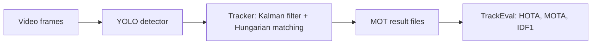

<h1 align="center">multi-object-tracking-bytetrack</h1>

<p align="center">
Tracking pedestrians with persistent IDs: YOLO detections, a Kalman-filter SORT baseline and ByteTrack, scored on MOT17 with HOTA, MOTA and IDF1.
</p>

<p align="center">
  <a href="https://github.com/haroonkhan02/multi-object-tracking-bytetrack/actions/workflows/ci.yml"></a>
  
  
</p>

> **Work in progress.** The MOT17 download, file I/O, sequence loader, tune/validation split and
> dataset statistics are in place. Next come the detector, the Kalman filter with SORT and
> ByteTrack, then evaluation with TrackEval, a demo video and a failure analysis. This README
> will be rewritten with results when the project is finished.

## Planned approach



- **Data:** the seven MOT17 training sequences. The test set has no public ground truth, so each
  sequence is split in half: the first half is for tuning tracker parameters, the second half for
  the reported numbers.
- **Detector:** a COCO-pretrained YOLO, keeping only the person class.
- **Trackers:** SORT as the baseline, then ByteTrack, which also matches low-confidence
  detections instead of discarding them. Both use a constant-velocity Kalman filter and
  Hungarian assignment.
- **Metrics:** HOTA, MOTA, IDF1, ID switches and FPS, computed with TrackEval.

## Getting started

```bash
uv venv --python 3.12 && source .venv/bin/activate
uv pip install -e ".[dev]"
mot-download     # 5.9 GB archive from motchallenge.net, resumable; extracts the train sequences
mot-check        # per-sequence statistics -> reports/dataset_stats.md
pytest -q
```

## Repository structure

```text
src/mot_track/
  config.py         paths and MOT17 constants
  download.py       resumable download and selective extraction
  mot_format.py     read/write MOTChallenge text files, ground-truth classes
  dataset.py        Sequence: frames, ground truth, public detections
  splits.py         tune / validation halves
  boxes.py          box conversions and IoU
  viz.py            draw boxes and IDs
  dataset_stats.py  per-sequence statistics and a ground-truth figure
tests/              synthetic sequence fixtures, no dataset needed
reports/            dataset statistics and figures
```

## License

MIT, see [LICENSE](LICENSE). MOT17 is distributed by [motchallenge.net](https://motchallenge.net/data/MOT17/) under CC BY-NC-SA 3.0 and is not included in this repository.
