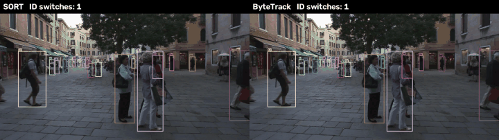
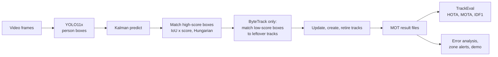
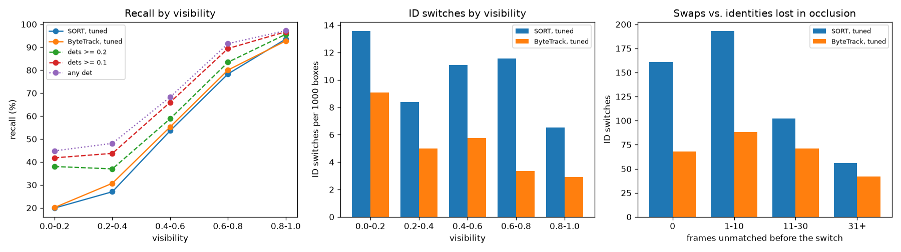

<div align="center">

# Multi-Object Tracking: SORT vs ByteTrack

Tracking pedestrians with persistent IDs: a COCO-pretrained YOLO11x detector, a Kalman filter with Hungarian matching, and two association strategies (SORT and ByteTrack), scored on MOT17 with HOTA, MOTA and IDF1.

[](https://github.com/haroonkhan02/multi-object-tracking-bytetrack/actions/workflows/ci.yml)




<sub>MOT17-02, frames 331–480 (validation half), same detections for both trackers. The counter is the running number of ID switches against the ground truth. I picked this crowded stretch because it shows the difference most clearly; over all sequences ByteTrack has about half the switches.</sub>

</div>

## What it does

- Detects people in every frame with YOLO11x (COCO weights, person class only) and caches the boxes.
- Tracks them with my own implementations of SORT and ByteTrack, which share one constant-velocity Kalman filter and one Hungarian matcher, so any difference comes from the association logic.
- Tunes each tracker on the first half of every MOT17 training sequence and reports HOTA, MOTA, IDF1 and ID switches on the second half with TrackEval.
- Breaks errors down by visibility, box size and crowding, and separates ID swaps from identities lost during occlusion.
- Counts danger-zone alerts per person, the use case from my [construction-safety project](https://github.com/haroonkhan02/construction-safety-lidar-vision), to see how ID switches turn into duplicate alerts.



## Results

Validation halves of the seven MOT17 training sequences (54,042 annotated boxes). Parameters were tuned on the first halves only.

| Tracker | Detections | HOTA | AssA | MOTA | IDF1 | ID switches |
|---|---|---|---|---|---|---|
| SORT, paper defaults | YOLO11x | 43.9 | 50.2 | 41.9 | 49.6 | 395 |
| SORT, tuned | YOLO11x | 48.9 | 52.9 | 43.8 | 56.4 | 512 |
| ByteTrack, paper defaults | YOLO11x | 46.5 | 56.8 | 41.4 | 53.8 | 144 |
| **ByteTrack, tuned** | YOLO11x | **51.1** | 56.7 | **45.7** | **59.8** | 269 |
| SORT | public Faster R-CNN | 48.1 | 55.7 | 46.4 | 54.7 | 258 |
| ByteTrack | public Faster R-CNN | 49.8 | 58.5 | 47.5 | 57.2 | 209 |

Tuned ByteTrack beats tuned SORT on all seven sequences (by 0.8 to 4.5 HOTA) and has about half the ID switches. Both tuned trackers lower the detection threshold to 0.2, which trades extra false positives for recall; that is why the tuned SORT has more ID switches than its defaults but still scores higher. Detection is the bottleneck: DetA stays around 47 because the detector was trained on COCO, not on MOT17 or CrowdHuman like the published ByteTrack models. YOLO11x at 1280 px runs at 4.6 FPS on an M5 GPU (MPS); both trackers run at over 2,000 FPS, so the pipeline speed is set by detection. Per-sequence tables and the parameter grids are in [`reports/`](reports).

### Where the errors are



| Box group | Boxes | SORT recall | ByteTrack recall | Covered by a detection ≥ 0.2 |
|---|---|---|---|---|
| Visibility < 0.2 | 11,576 | 19.9 % | 20.2 % | 38.0 % |
| Visibility ≥ 0.8 | 20,961 | 93.5 % | 92.8 % | 95.6 % |
| Overlap with another person > 0.3 IoU | 16,853 | 48.4 % | 50.2 % | 68.2 % |

- Heavily occluded people are the main source of misses. Even the detector only covers 38 % of them, and the trackers recover about half of that.
- In crowds the trackers lose recall the detector still has: 18 to 20 points between "a detection exists" and "the tracker reported it". Boxes in a crowd compete for the same track during matching.
- ByteTrack has fewer ID switches in every visibility bin. Direct swaps between neighbours drop from 161 to 68. Identities lost after more than 30 unmatched frames barely change (56 vs 42): a motion-only tracker has nothing to recognise a person by once the track buffer runs out.

Danger-zone alerts on the three static-camera sequences (a fixed zone in the lower middle of the image, one alert per person who stays at least 1 s): of 27 real visits, SORT raised 22 correct alerts and 5 duplicates, ByteTrack 21 correct and 3 duplicates. With so few visits that difference is within noise; the [full table](reports/zone_alerts.md) also lists false and missed alerts.

## Getting started

```bash
uv venv --python 3.12 && source .venv/bin/activate
uv pip install -e ".[dev]"
pytest -q                  # synthetic sequences, no dataset or GPU needed

mot-download               # MOT17 (5.9 GB) from motchallenge.net, resumable; extracts train
mot-check                  # per-sequence statistics -> reports/dataset_stats.md
uv pip install -e ".[detect,eval]"
mot-detect                 # YOLO11x person boxes for every frame, cached in outputs/
mot-experiments tune       # parameter grid on the first halves -> reports/tuning.md
mot-experiments val        # SORT vs ByteTrack on the second halves -> reports/results_val.md
mot-analyse                # error breakdown -> reports/error_analysis.md
mot-zones                  # danger-zone alerts -> reports/zone_alerts.md
mot-demo --seq MOT17-02 --start 331 --frames 150   # side-by-side video + assets/demo.gif
mot-track --tracker bytetrack --split val          # one tracker on its own
```

## Repository structure

```text
src/mot_track/
  config.py         paths and MOT17 constants
  download.py       resumable download and selective extraction
  mot_format.py     MOTChallenge text files, ground-truth classes
  dataset.py        Sequence: frames, ground truth, public detections
  splits.py         tune / validation halves
  boxes.py          box conversions and IoU
  dataset_stats.py  per-sequence statistics and a ground-truth figure
  detect.py         YOLO person detector, cached per sequence
  kalman.py         constant-velocity Kalman filter on (cx, cy, aspect, height)
  association.py    IoU cost, score fusion, Hungarian matching
  trackers.py       SORT and ByteTrack
  track.py          run a tracker over cached detections
  evaluate.py       TrackEval wrapper (HOTA, CLEAR, Identity) on split halves
  experiments.py    parameter search and validation runs
  analysis.py       CLEAR matching per box, breakdown by visibility, size, crowding
  zones.py          per-identity danger-zone alerts scored against ground truth
  demo.py           side-by-side video and GIF with an ID-switch counter
  viz.py            draw boxes and IDs
tests/              synthetic sequence fixtures
reports/            dataset statistics, tuning grid, results, error analysis, figures
assets/demo.gif
```

## Design decisions

| Decision | Why |
|---|---|
| Split every training sequence in half (tune / validate) | MOT17 test labels are private. Tuning and reporting on the same frames would overstate both trackers. |
| One Kalman filter and matcher for both trackers | Isolates the effect of ByteTrack's two-round association. |
| COCO-pretrained detector, no fine-tuning | Shows what tracking adds on top of an off-the-shelf detector; also reported with the public MOT17 detections for comparison. |
| HOTA as the tuning target | MOTA mostly rewards detection and IDF1 mostly association; HOTA balances both. |
| Own CLEAR matcher for the error analysis | TrackEval only reports totals. Re-matching per box reproduces TrackEval's totals (512 / 269 ID switches, 60.4 % / 61.1 % recall), so the breakdown adds up to the reported numbers. |

## Limitations and future work

- The tuned ByteTrack thresholds sit on the lower edge of the search grid even after extending it twice, so the optimum may be lower still.
- I haven't ablated which ByteTrack component (low-score second round, score fusion, separate track-creation threshold) gives most of the gain.
- No appearance features: long occlusions end in a new ID. A re-identification embedding (DeepSORT, BoT-SORT) is the next step, as is camera-motion compensation for the moving-camera sequences.
- Fine-tuning the detector on MOT17 + CrowdHuman would raise DetA, which caps every other number here.
- Results are on MOT17 training sequences only, not the official test server.
- Tracking people raises privacy concerns. MOT17 is a public research dataset; any deployment on real video needs consent, a legal basis and data minimisation (for example, keeping only zone events instead of trajectories).

## License

MIT, see [LICENSE](LICENSE). MOT17 is distributed by [motchallenge.net](https://motchallenge.net/data/MOT17/) under CC BY-NC-SA 3.0 and is not included. TrackEval (MIT) is by Jonathon Luiten; YOLO11 weights are from Ultralytics (AGPL-3.0).
